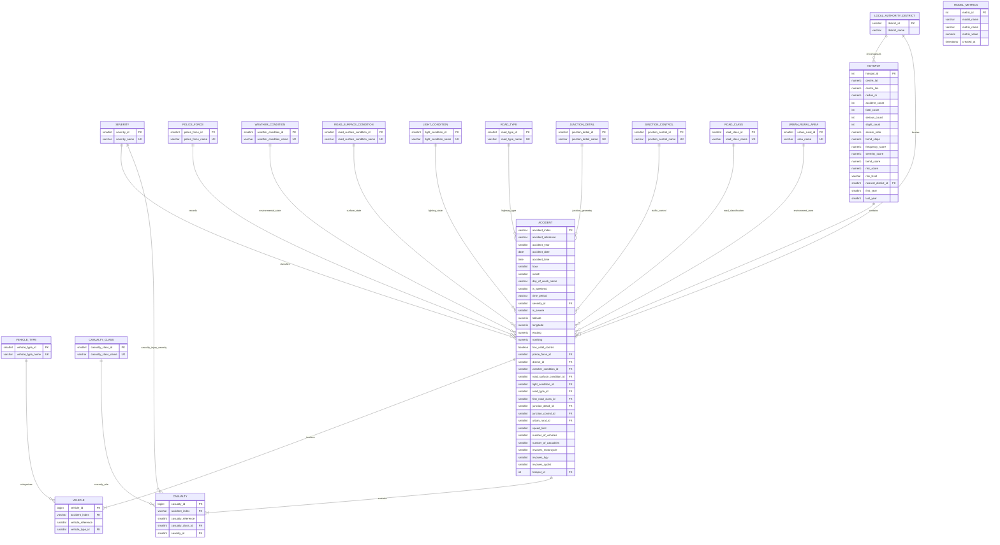

# Entity-Relationship Diagram (ERD)

This document visualizes the relational database schema of the **Smart Road Accident Hotspot Analysis and Risk Prediction System**.

---

## 1. Complete Relational ERD (Mermaid)

---

## 2. Table Summary & Relationship Cardinalities

| Relationship | Parent Entity | Child Entity | Cardinality | Business Meaning |
|---|---|---|---|---|
| `accident_severity` | `severity` | `accident` | $1 : N$ | Every collision has exactly one severity classification (Fatal, Serious, Slight). |
| `accident_police` | `police_force` | `accident` | $0..1 : N$ | Accidents are recorded under a specific police force jurisdiction. |
| `accident_district` | `local_authority_district` | `accident` | $0..1 : N$ | Accidents occur within a municipal district boundary. |
| `accident_environment` | `weather_condition`, etc. | `accident` | $0..1 : N$ | Situational factors linked via foreign keys. |
| `accident_vehicles` | `accident` | `vehicle` | $1 : 1..N$ | An accident involves one or more vehicles. |
| `accident_casualties` | `accident` | `casualty` | $1 : 1..N$ | A personal-injury accident results in one or more casualties. |
| `hotspot_accidents` | `hotspot` | `accident` | $0..1 : N$ | Accidents identified as density clusters belong to a spatial hotspot. |
| `hotspot_district` | `local_authority_district` | `hotspot` | $0..1 : N$ | Hotspots are assigned to their nearest administrative district. |
