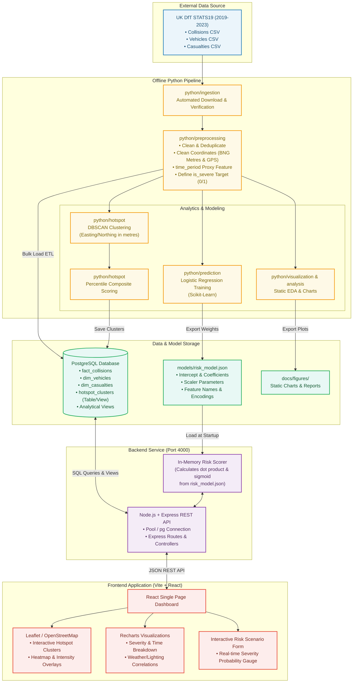

# System Architecture & Pipeline Design

This document details the architectural layout, data flow, and system components of the **Smart Road Accident Hotspot Analysis and Risk Prediction System**.

---

## 1. System Pipeline Diagram

---

## 2. Key Component Descriptions

| Component | Technology | Primary Responsibility |
|---|---|---|
| **Data Ingestion & Cleaning** | Python (`pandas`, `numpy`) | Downloads STATS19 records (2019–2023), removes invalid spatial rows, generates the `time_period` rush-hour proxy, and binarizes severity into `is_severe`. |
| **Spatial Hotspot Engine** | Python (`scikit-learn` DBSCAN) | Performs density clustering using British National Grid metric coordinates ($Easting, Northing$), and computes equal-weight composite hotspot percentile ranks. |
| **Prediction Engine (Training)** | Python (`scikit-learn` LogisticRegression) | Trains an explainable logistic regression model on situational and environmental factors and exports parameter weights as JSON. |
| **Relational Database** | PostgreSQL | Stores cleaned relational collision, vehicle, casualty records and indexed spatial/analytical views for efficient sub-second dashboard queries. |
| **API Server & Scorer** | Node.js + Express | Serves REST endpoints for map bounding boxes, hotspot lists, aggregated charts, and computes scenario risk predictions directly in memory. |
| **Interactive Dashboard** | React + Vite + Tailwind + Leaflet + Recharts | Responsive web application presenting interactive spatial maps, analytical charts, filtering controls, and the real-time risk predictor. |
